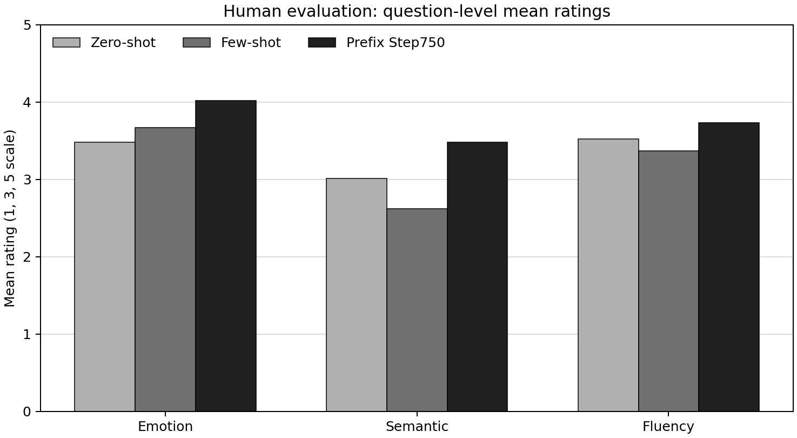
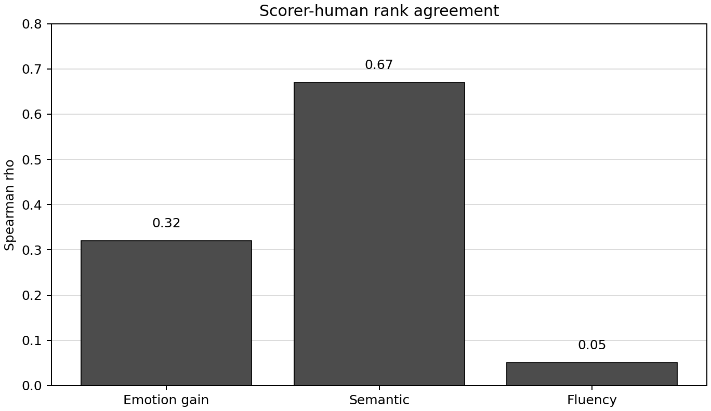

# EmotionGain_RL

EmotionGain_RL 是情緒強化改寫專題的研究程式。研究以凍結的 Llama-3.2-3B 為底模，嘗試將中性的英文任務通知改寫得更有喜悅感，同時保留原事件、減少照抄，並維持可讀性。

訓練只更新各情緒的 Prefix 向量。六種情緒、Prefix 長度 20、隱藏維度 3072，共有 368,640 個可訓練數值，約為底模參數量的 0.012%。

## 方法概述

1. 凍結底模，只更新目標情緒對應的 Prefix。
2. 先以 Warm-up 的 teacher forcing 學習改寫格式。
3. 在 RL 階段生成候選句，檢查格式、照抄、語意保留、NLI 矛盾、情緒增益、流暢度與精簡度。
4. 未通過 Threshold 的句子給予負 reward；通過者依多維評分計算 reward，再以 REINFORCE 更新 Prefix。
5. 加入逐 token 的 KL 正則化，約束目前策略與固定 Warm-up 策略之間的差距。

通過 Threshold 後，基礎獎勵的預設公式為：

`R = 0.35e + 0.30s + 0.20f + 0.15c - P`

各分數的意義與後續限制見 [方法說明](docs/method.md)。

## 真人評估

正式比較使用 60 個來源句、三種方法（Zero-shot、Few-shot、Prefix Step750），共有 38 位一般讀者完成評估。每個來源句有 1–6 份評分，因此先計算逐題平均，再進行配對分析。

經 Holm 多重比較校正後，Prefix 的情緒評分顯著高於 Zero-shot，語意保留評分顯著高於 Few-shot，整體最佳選擇率也顯著高於兩種基準方法。其他維度比較未達校正後的顯著門檻，因此不能解讀成所有面向都優於基準。

## 評分器與真人評分的關係

評分器提供訓練訊號，不等同真人判斷。主要 Spearman 等級相關係數為：情緒增益 0.32、語意保留 0.67、流暢度 0.05。

語意保留是目前與真人評分最一致的部分；情緒的對齊程度有限，GPT-2 流暢度特徵也不能代替真人對自然程度的判斷。詳見 [研究限制](docs/limitations.md)。
